# nerdcules

A directory of my public projects: tools for AI coding assistants, and desktop apps for
[Omarchy](https://omarchy.org) (Arch Linux + Hyprland) in C++ and Qt Quick.

> **Who made these.** The ideas are mine: what each project is for, what it should do, and how it
> should look. The code and the docs are written by AI, by Claude (Anthropic) working in
> [Claude Code](https://claude.com/claude-code). Each section below says so for its project, with
> the share of commits that carry Claude's `Co-Authored-By` line.

| Project | What it is | Language | Release |
|---|---|---|---|
| [CodeGraph](#codegraph) | Code graph MCP server: who calls this, what breaks if I change it, which tests guard it | C# |  |
| [sankofa](#sankofa) | Shared memory and file locks for many AI coding sessions on one codebase | C# |  |
| [Fathom](#fathom) | A Windows-inspired desktop layer for Omarchy, built for Docker, .NET and AI work | QML | – |
| [o-rdp](#o-rdp) | Finds the PCs with Remote Desktop on your network and connects to them | C++ / Qt Quick | – |
| [Snoopy](#snoopy) | What each app on a connected Android phone reads, and where it connects | C++ / Qt Quick | – |

---

## CodeGraph

**[github.com/nerdcules/CodeGraph](https://github.com/nerdcules/CodeGraph)**  
Idea: mine · Written by: Claude, in Claude Code · 77 of 99 commits co-authored by Claude (counted 17 Nov 2026)

Gives your AI coding assistant the compiler's answers: who calls this, what breaks if I change it,
which tests guard it. It reads a codebase with its compiler (C#, TypeScript and Angular, Java, Go,
Rust, Python), stores what it finds as a graph, and serves that graph to the assistant as MCP tools.
It sets itself up for Claude Code, GitHub Copilot, Codex, Cursor, the Gemini CLI, and the Roo Code,
Kilo Code and Continue extensions.

[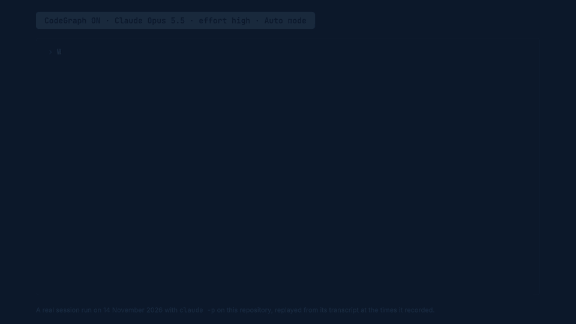](https://github.com/nerdcules/CodeGraph)

*A real Claude Code session (14 November 2026), replayed from its transcript. With CodeGraph the
assistant answered in 42 s with four codegraph calls; without it, 87 s and eight shell commands.
Details and the later run-time check are in the
[CodeGraph README](https://github.com/nerdcules/CodeGraph#readme).*

<table><tr>
<td width="50%">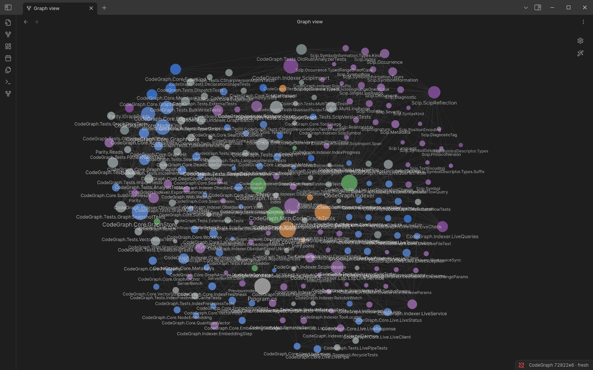</td>
<td width="50%">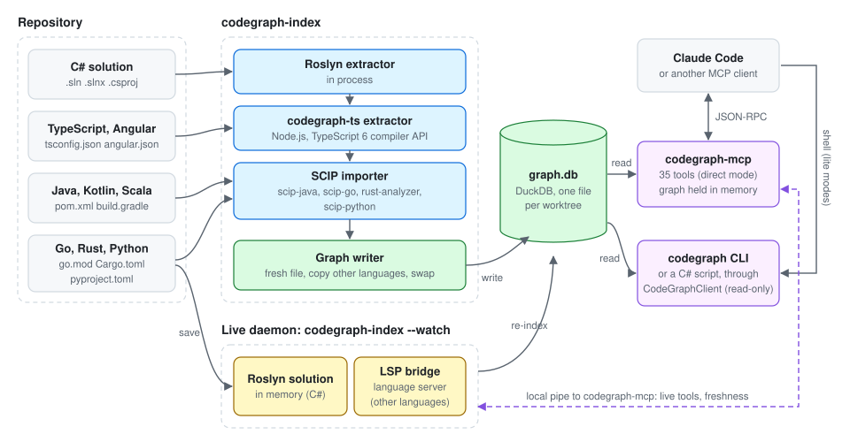</td>
</tr><tr>
<td>The graph as an Obsidian vault</td>
<td>Extractors write the graph, the MCP server reads it, a daemon keeps it current</td>
</tr></table>

## sankofa

**[github.com/nerdcules/sankofa](https://github.com/nerdcules/sankofa)**  
Idea: mine · Written by: Claude, in Claude Code · 50 of 56 commits co-authored by Claude (counted 17 Nov 2026)

*Sankofa* (Akan): "go back and fetch it." One small ledger that every AI coding session, subagent,
client and machine goes back to: what was done, what is open, who is working on which files, what to
do next. With Claude Code every edit is leased before it happens, so a second session touching the
same files is refused by name. Linux, macOS and Windows share one ledger.

<table><tr>
<td width="50%">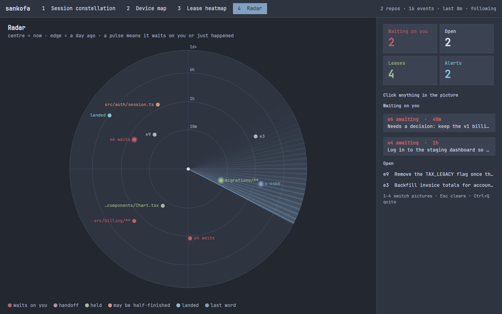</td>
<td width="50%">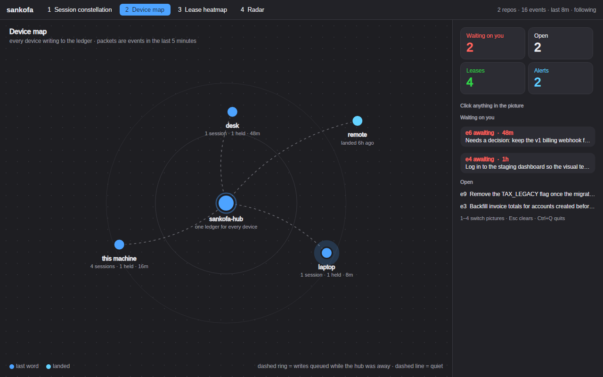</td>
</tr><tr>
<td>Radar: what waits on you, what is open, who holds what</td>
<td>Device map: every machine writing to the ledger</td>
</tr></table>

## Fathom

**[github.com/nerdcules/fathom](https://github.com/nerdcules/fathom)**  
Idea: mine · Written by: Claude, in Claude Code · 28 of 28 commits co-authored by Claude (counted 17 Nov 2026)

A futuristic, Windows-inspired desktop layer for Omarchy, built for Docker, .NET and AI work:
a desktop theme with a glassy bar, a Start menu, the Command Deck (system, containers, .NET apps and
AI agents on one page), Alt+Tab with previews, Task view, Snap layouts, Quick settings, a
mini-player, mail notifications and a sign-in screen. Each part installs on its own.

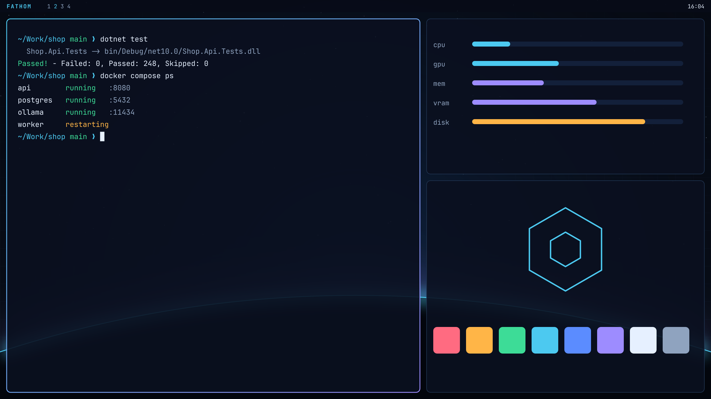

<table><tr>
<td width="50%">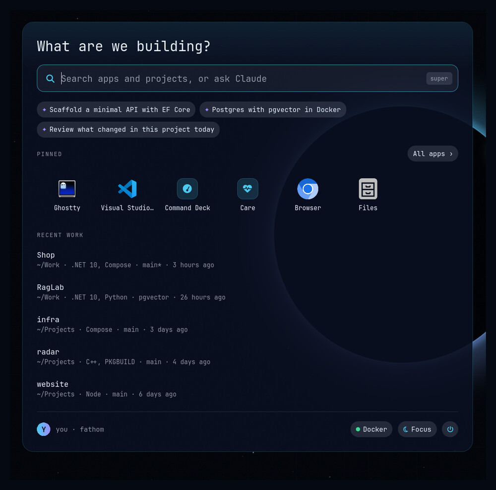</td>
<td width="50%">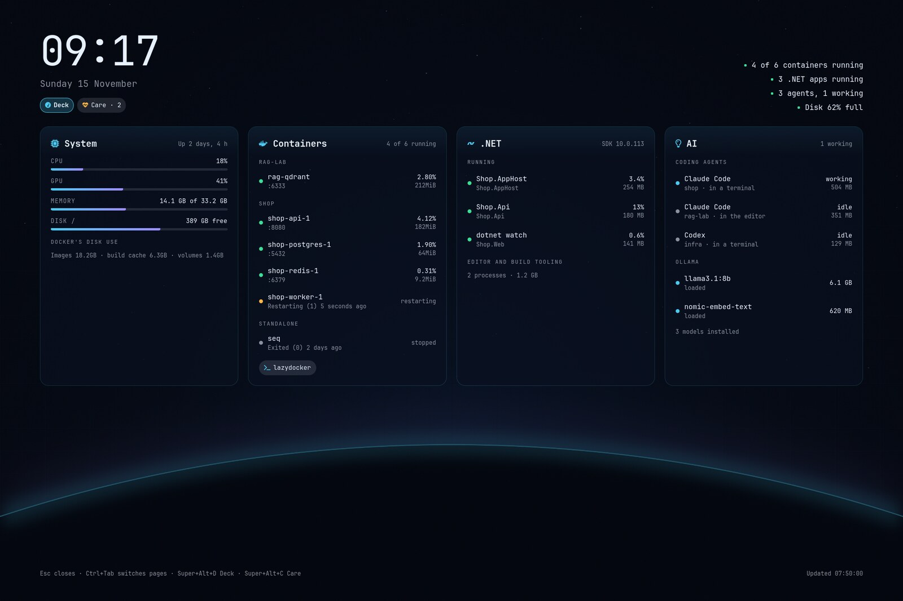</td>
</tr><tr>
<td>Start menu</td>
<td>Command Deck</td>
</tr></table>

## o-rdp

**[github.com/nerdcules/o-rdp](https://github.com/nerdcules/o-rdp)**  
Idea: mine · Written by: Claude, in Claude Code · 2 of 2 commits co-authored by Claude (counted 17 Nov 2026)

Finds the PCs with Remote Desktop on your local network and connects to them with FreeRDP. It scans
the subnet of the default route for port 3389, names each PC (NetBIOS, reverse DNS, then Avahi),
keeps passwords in the GNOME keyring if you ask it to, and says what went wrong when a connection
fails. Keyboard-driven.

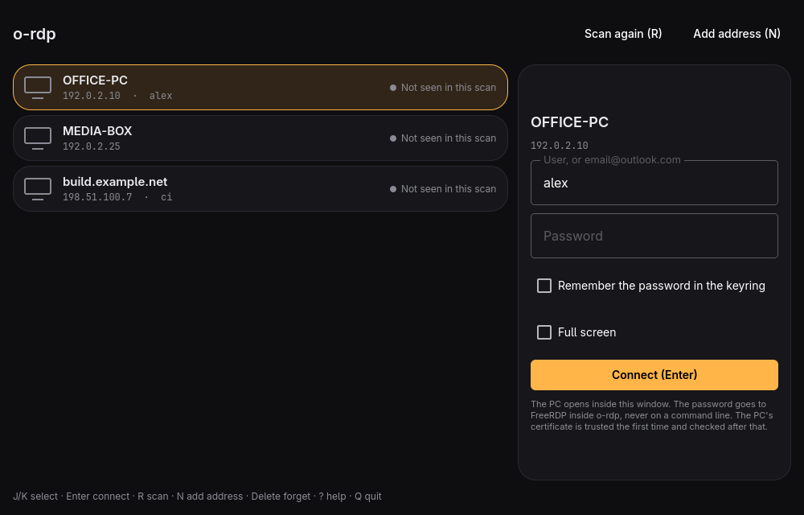

## Snoopy

**[github.com/nerdcules/snoopy](https://github.com/nerdcules/snoopy)**  
Idea: mine · Written by: Claude, in Claude Code · 26 of 28 commits co-authored by Claude (counted 17 Nov 2026)

For an Android phone plugged into this computer, shows what each app recently read (location,
camera, microphone, contacts, photos, clipboard and more) and where it is connected: the address,
its reverse DNS name, the port, and the names the phone looked up. It reads the phone over adb;
nothing is installed on the phone and nothing is decrypted.

<table><tr>
<td width="50%">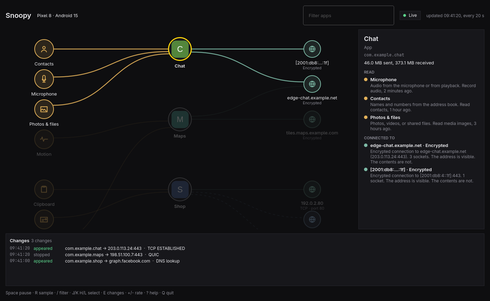</td>
<td width="50%">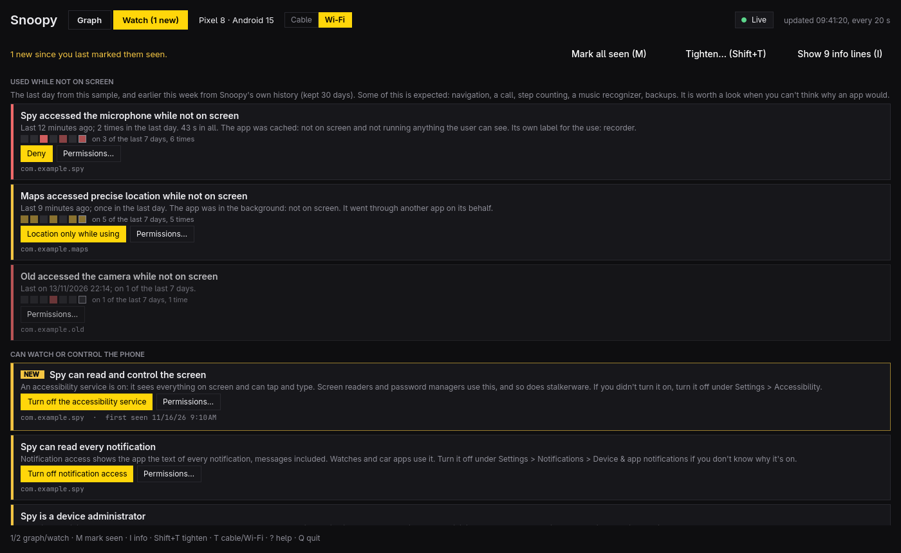</td>
</tr><tr>
<td>Apps, what they read, where they connect</td>
<td>The Watch page</td>
</tr></table>

---

Ideas: mine. Code and writing: Claude, in Claude Code. Commit counts come from each repo's
history on GitHub on 17 Nov 2026; a commit without the trailer is not a claim either way.
Screenshots are copies of the ones in each project's own repo; `bin/refresh-images` fetches
them again (sources in [images/SOURCES](images/SOURCES)).
